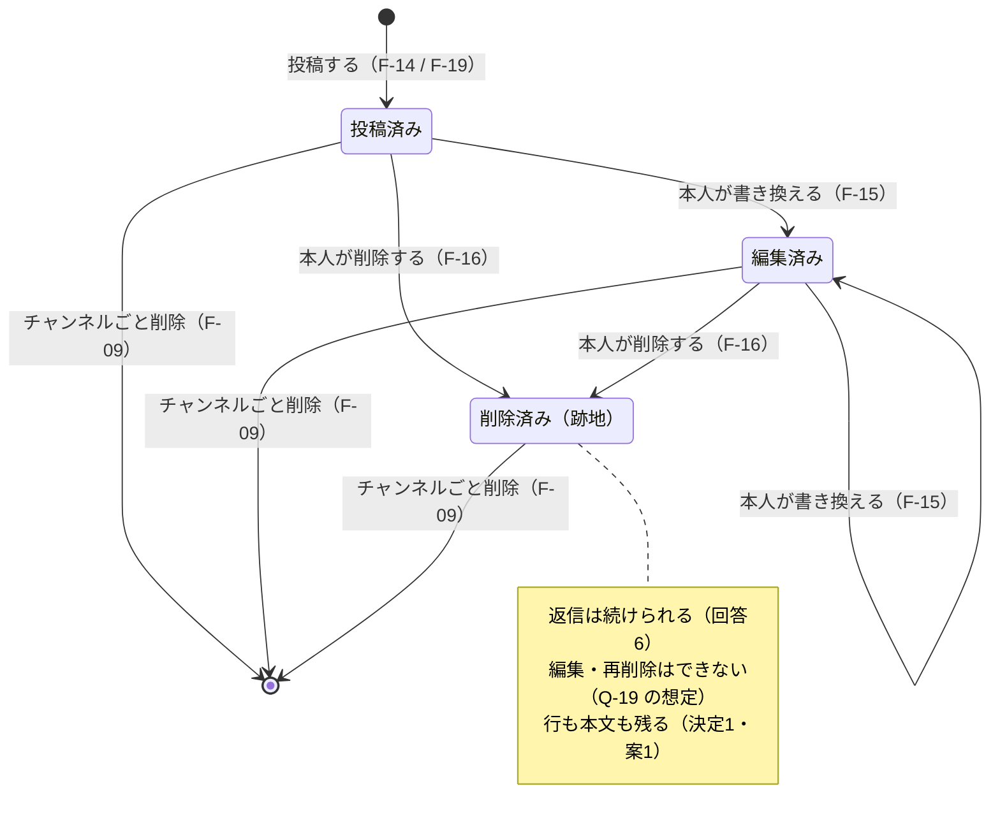
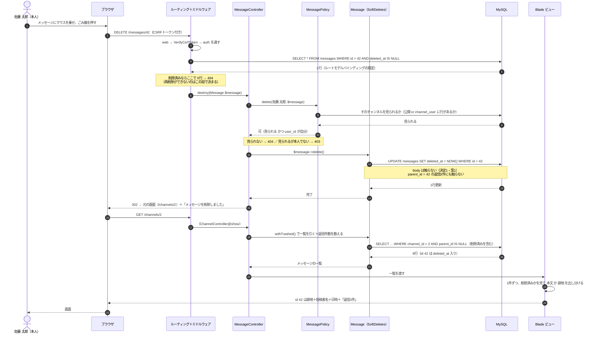

# ふるまい設計（状態遷移図・代表的な処理のシーケンス図・例外方針）

- 対象: チームチャットアプリ
- 典拠: `docs/spec.md`、`mockup/`（画面見本10枚・`design-guide.md`）、`docs/design/features.md`・`questions.md`・`screens.md`・`data.md`・`permissions-api.md`
- この文書は「**動いているときに何が起きるか**」だけを書きます。画面の中身は `screens.md`、データの持ち方は `data.md`、URLと権限は `permissions-api.md` に分けます
- 動かす環境: Laravel 10.10（`composer.json`）・MySQL 8.4（Laravel Sail）
- **クラス図は作りません。Laravel の MVC の標準の作り（ルーティング → コントローラ → フォームリクエスト／ポリシー → Eloquent モデル → Blade ビュー）に、そのまま乗せます。**

---

## 1. 状態遷移図（メッセージ）

状態を持つのは**メッセージ（返信を含む）だけ**です。ほかのものを図にしなかった理由は 1-5 に書きました。

### 1-1. 図



### 1-2. 状態の定義

「DBの値」の列が、この3つの状態の正体です。状態を表す列を別に持たず、`edited_at` と `deleted_at` の2本の有無で表します（`data.md` 2-4）。

| 状態 | `edited_at` | `deleted_at` | 画面（SC-06・SC-07） | 検索（F-20） | 公開API（F-22） |
|:--|:--|:--|:--|:--|:--|
| **投稿済み** | NULL | NULL | 本文をそのまま出す | 出る | 出る |
| **編集済み** | 値あり | NULL | 本文＋末尾に「編集済み」 | 出る | 出る（`edited: true`） |
| **削除済み（跡地）** | **そのまま** | 値あり | 破線の枠に「このメッセージは削除されました」。**投稿者名・日時・返信件数は残す** | **出ない** | **出ない** |
| （消滅） | — | — | 行がないので何も出ない | 出ない | 出ない |

- **削除済みでも `edited_at` は消しません。**消す理由がなく、消すと「もとは編集されていた」ことが分からなくなります。ただし跡地には本文を出さないので、「編集済み」の印も画面には出ません
- **削除済みでも `body` は残ります**（`questions.md` 決定1・案1）。画面・検索・公開APIのどこにも出しませんが、データベースには入っています
- 「消滅」は状態ではなく、行が無くなったことです。図では終了（`[*]`）に当たります

### 1-3. 遷移の表

| # | 遷移 | きっかけ | F番号 | できる人 | 前提 | DBの変化 | 典拠 |
|:--|:--|:--|:--|:--|:--|:--|:--|
| 1 | （なし）→ 投稿済み | SC-06 の投稿欄で送信 | F-14 | そのチャンネルを見られる人（列C） | 本文が1〜1,000文字 | `messages` に1行 INSERT（`parent_id` は NULL） | 仕様書 3-4 |
| 2 | （なし）→ 投稿済み | SC-07 の返信欄で送信 | F-19 | 同上 | 本文が1〜1,000文字／**親が返信でない**（△4） | `messages` に1行 INSERT（`parent_id` に親のID・`channel_id` は親と同じ） | 仕様書 3-5 / 回答8 |
| 3 | 投稿済み → 編集済み | その場の入力欄で保存 | F-15 | 書いた本人（列D） | **いまもそのチャンネルを見られる**（△3 の（1））／削除済みでない（△3 の（3））／本文が1〜1,000文字 | `body` を UPDATE ＋ `edited_at` に現在時刻。**`created_at` は変えない** | 仕様書 3-4 / Q-17 の想定 |
| 4 | 編集済み → 編集済み | 同上 | F-15 | 同上 | 同上 | `body` を UPDATE ＋ `edited_at` を上書き | 回答5（期限なし・印は消えない） |
| 5 | 投稿済み／編集済み → 削除済み | ホバー操作のごみ箱 | F-16 | 書いた本人（列D） | **いまもそのチャンネルを見られる**（△3 の（1））／削除済みでない（△3 の（3）） | **`deleted_at` に現在時刻を UPDATE。`body` は触らない** | 仕様書 3-4 / `questions.md` 決定1 |
| 6 | すべて → 消滅 | SC-10 で確定 | F-09 | そのチャンネルの作成者（列E） | 確認の入力がチャンネル名と一致 | `channels` の行を**物理削除**。`messages`・`channel_user` は外部キーの連鎖で消える | 回答2 / Q-11 |

**起きない遷移**（図に線を引かなかったもの）

| 起きないこと | 理由 | 典拠 |
|:--|:--|:--|
| 削除済み → 投稿済み（画面から戻す） | 復元の導線は作りません。戻すのはデータベースを直接触る手作業です | `questions.md` 決定1 のリスク5 |
| 削除済み → 削除済み（再削除） | 削除済みは編集も再削除もできません（△3）。ルートモデルバインディングの既定で落ち、404 になります | Q-19 の想定 / `permissions-api.md` 1-5 |
| 削除済み → 編集済み | 同上 | 同上 |
| 編集済み → 投稿済み（印が消える） | 「編集済み」の印は一度付いたら消えません | 回答5 |
| 投稿済み → 消滅（1件だけ物理削除） | メッセージ1件の削除は論理削除です。物理削除はチャンネルごと消すときだけ（`data.md` 3-2） | 回答2 / `questions.md` 決定1 |

**状態が変わっても変わらないもの**

| 変わらないもの | なぜ |
|:--|:--|
| `created_at`（画面に出す日時） | 編集しても書いたときのままです（Q-17 の想定） |
| `user_id`（投稿者） | 跡地にも投稿者名を出します（仕様書 3-4） |
| ぶら下がっている返信 | 親を削除しても返信には触りません。件数も減りません（回答6 / Q-23 の想定） |
| `channel_id` | 移動する機能はありません |

### 1-4. 返信件数の数え方（状態をまたぐところ）

状態の定義と数え方が食い違いやすい1点なので、別に書き出します。

| どこ | 親が削除済みのとき | 返信が削除済みのとき | 典拠 |
|:--|:--|:--|:--|
| 画面の「返信◯件」（F-17） | **件数を出す**（消さない） | **数に含める** | `design-guide.md` 4 / Q-23 の想定 |
| 公開APIの `reply_count`（F-22） | 親そのものが応答に出ない | **数に含めない** | 回答11 / `permissions-api.md` 3-3 |

画面側は `withTrashed()` を効かせたうえで数えます（`withCount` の既定では削除済みの返信が落ちます）。**ここは書き忘れると「返信3件」が「返信2件」に減る**ので、受け入れ条件に入れます（`questions.md` 決定1 の出口1-c）。

### 1-5. 図にしなかったもの

`README.md` の「書く量の決まり」に沿って、状態遷移図は**メッセージ1つだけ**にしました。ほかのものを足さなかった理由です。

| もの | 状態と呼べるもの | 足さなかった理由 |
|:--|:--|:--|
| チャンネル | 「ある」と「消えた」の2つだけ | 遷移が1本（物理削除）で、図にしても線が1本引かれるだけです。公開範囲は作成時に決めて変わりません（Q-09 の想定） |
| メンバー（`channel_user`） | 「入っている」と「入っていない」の2つだけ | 行の有無がそのまま状態で、更新する属性がありません（`data.md` 4-2） |
| アカウント | 作られたあと変わりません | プロフィール編集・退会・停止をどれも作りません（回答13 / `features.md` 2-3） |
| ログイン状態 | ログイン済み／未ログイン | 画面遷移図（`screens.md` 2-1）で足ります |
| 編集中・下書き | 画面の中の状態 | 保存されないので、データの状態ではありません。見せ方は `screens.md` 3-3 |

---

## 2. 代表的な処理のシーケンス図

### 2-1. この1本を選んだ理由

`README.md` の決まりどおり、**代表を1本だけ**描きます。選んだのは

> **スレッドの返信が付いたメッセージを、書いた本人が削除したとき**（F-16）

です。この1本に、ほかの流れでは確かめられないものが重なっています。

| 重なっているもの | なぜここでしか見えないか |
|:--|:--|
| 権限の判定の順番 | 「チャンネルを見られるか（404側）」→「本人か（403側）」の2段を通ります（`permissions-api.md` 1-5） |
| 論理削除（決定1・案1） | `deleted_at` を立てるだけで、`body` と返信に触らないことが図に出ます |
| 削除済みを**あえて取ってくる**経路 | 削除後の一覧は `withTrashed()` で跡地を取り、ビューで出し分けます（決定1 の出口1）。ほかの流れには出てきません |
| 削除済みを**取ってこない**経路 | 同じ `messages` を読む検索と公開APIは、既定のまま除外されます（決定1 の出口2・3） |
| 返信が残ること | 親を消しても件数が減らないこと（回答6 / Q-23 の想定）が、同じ図の中で確かめられます |

### 2-2. 図

前提: 佐藤 太郎が `#開発`（`id` 2）を開いていて、自分が書いた `id` 42 のメッセージには返信が3件ぶら下がっています。



### 2-3. 図の中の決めどころ

| # | 決めどころ | 決めたこと | もし逆にすると | 典拠 |
|:--|:--|:--|:--|:--|
| 1 | **削除のルートのバインディング**（図 4〜6） | **既定のまま**（削除済みを除外）。削除済みを消そうとすると 404 | `withTrashed()` を付けると、削除済みを何度でも「削除」できてしまい、`deleted_at` が上書きされます | Q-19 の想定 |
| 2 | **判定の順番**（図 9〜13） | **チャンネルを見られるか → 本人か**。前者で落ちたら 404、後者で落ちたら 403。**前者は絶対の前提**で、`MessagePolicy` は必ず `ChannelPolicy@view` を先に通します | 順番を逆にすると、（1）見えないプライベートチャンネルのメッセージに 403 が返って存在が漏れ、（2）**プライベートチャンネルから外された人が、自分の過去のメッセージを編集・削除できてしまいます**（仕様書 3-3 に反します） | **仕様書 3-3** / 回答1 / Q-15 の想定 / `permissions-api.md` 1-5・1-6 |
| 3 | **`delete()` のときに本文を触らない**（図 15〜16） | `SoftDeletes` を素のまま使い、`deleting` で `body` を書き換える処理は**入れません** | 案2a（本文を NULL に）の名残が混ざり、誤削除から戻せなくなります | `questions.md` 決定1 の申し送り |
| 4 | **返信に触らない**（図 16 の注記） | `parent_id = 42` の3件はそのまま。件数も減りません | 返信も一緒に消すと、回答6（削除済みにも返信を続けられる）と Q-23（件数を消さない）の両方が破れます | 回答6 / Q-23 の想定 |
| 5 | **削除後の行き先**（図 19） | **元いた画面に戻します**（SC-06 から消したら SC-06、SC-07 から消したら SC-07）。スレッドから消しても親は跡地で残るので、404 にはなりません | チャンネル一覧に飛ばすと、消えたことを目で確かめられません | `thread.html`（削除済みの親でスレッドが開いている） |
| 6 | **一覧は `withTrashed()`**（図 22〜23） | 跡地を出すために、削除済みを**あえて取ってきます** | 付け忘れると、跡地が消えて前後の会話が繋がらなくなります（仕様書 3-4 が破れる） | `questions.md` 決定1 の出口1 |
| 7 | **出し分けはビューの1か所**（図 26） | 「本文を出すか跡地を出すか」の分岐を、**メッセージ1件ぶんの Blade 部品に閉じます**。一覧（SC-06）・スレッド（SC-07）はこの部品を通します | 画面ごとに書くと、どれか1つで出し分けを忘れたときに本文が出ます | `questions.md` 決定1 の出口1 |

### 2-4. この1本で確かめられないこと

1本だけなので、残りは受け入条件とテストに寄せます（`acceptance.md`）。

| 確かめられないこと | どこで確かめるか |
|:--|:--|
| 検索（F-20）と公開API（F-22）に、削除済みの本文が出ないこと | 図には「取ってこない」ことしか書けません。`questions.md` 決定1 の出口2・3 の観点で、**独立したテストとして**確かめます |
| 削除済みのメッセージに返信できること（F-19） | 同じく出口1-d の観点 |
| チャンネルごと削除したときに物理削除になること（F-09） | 別の流れです（4-5 のトランザクション） |
| 入力チェックに落ちたときの戻り方 | 4-3 |

---

## 3. 例外方針

### 3-1. 考え方

| 決まり | 内容 |
|:--|:--|
| **例外は投げて、1か所で受ける** | コントローラで `try`〜`catch` を並べません。`abort()` と例外を投げ、`app/Exceptions/Handler.php` で返し方を決めます |
| **画面と公開APIで返し方を分ける** | 画面は「人が読む形」（リダイレクト・エラー文・エラー画面）、公開APIは「機械が読む形」（JSONの `message` 1本）。分かれ目は Laravel の `expectsJson()` と、`/api` で始まるかどうかで判断します |
| **隠すものは文言も揃える** | 「ない」と「見せられない」を**同じ文言・同じステータス**で返します（`permissions-api.md` 1-5・3-5） |
| **中身を出さない** | 例外のクラス名・ファイル名・SQL・メッセージ本文を、画面にもJSONにも出しません（`APP_DEBUG=false` が前提） |
| **検査はサーバ側で必ず行う** | 画面側の文字数表示は打ちやすさのための補助です（`screens.md` 4-1） |

### 3-2. ステータスの割り当て

| 起きたこと | 例外 | 画面（web） | 公開API | 典拠 |
|:--|:--|:--|:--|:--|
| 入力チェックに落ちた | `ValidationException` | **302** で元の画面へ戻し、欄の下にエラー文（打った内容は残す） | 起きません（入力は `page` だけ） | `screens.md` 4章 |
| ログインしていない | `AuthenticationException` | **302 →** SC-01 | 起きません（認証を見ません） | Q-33 の想定 |
| ログイン済みで SC-01・SC-02 を開いた | （`guest` ミドルウェア） | **302 →** SC-03 | — | Q-04 の想定 |
| 見えないチャンネル／そのメッセージ（**プライベートチャンネルから外された人の、自分の過去のメッセージも含む**） | `ModelNotFoundException` | **404** | — | 仕様書 3-3 / 回答1 / Q-15 の想定 |
| 削除済みメッセージの編集・再削除 | `ModelNotFoundException` | **404** | — | Q-19 の想定 |
| 公開チャンネルでメンバー画面を開いた | `abort(404)` | **404** | — | `permissions-api.md` △1 |
| 見えるが操作できない（他人のチャンネル・他人のメッセージ） | `AuthorizationException` | **403** | — | 仕様書 3-2 / 3-4 |
| プライベートチャンネルのIDでAPIを叩いた | `ModelNotFoundException` | — | **404**（「ない」と同じ文言） | **仕様書 3-7 / 回答1** |
| 書き込み系のAPIを叩いた | `MethodNotAllowedHttpException` | — | **405** | 仕様書 3-7 |
| CSRFトークンが切れた | `TokenMismatchException` | **419** | 起きません（GETのみ） | — |
| 回数制限を超えた | `ThrottleRequestsException` | — | **429** | `RouteServiceProvider` |
| そのURLがない | `NotFoundHttpException` | **404** | **404** | — |
| それ以外の不具合 | `Throwable` | **500** | **500** | — |

### 3-3. 画面側の見せ方

| ステータス | 見せ方 | 文言 |
|:--|:--|:--|
| 302（入力チェック） | 元の画面に戻し、**その入力欄の下**に1文（句点なし）。欄の枠と地を赤に | `screens.md` 4章の表のとおり |
| 403 | エラー画面1枚 | 「この操作を行う権限がありません」 |
| 404 | エラー画面1枚 | 「お探しのページは見つかりません」 |
| 419 | エラー画面1枚 | 「時間が経ちすぎたため送信できませんでした。ページを開き直してください」 |
| 500 | エラー画面1枚 | 「申し訳ありません。サーバ側で問題が発生しました」 |

- エラー画面は `resources/views/errors/{403,404,419,500}.blade.php` に置きます（Laravel がステータスごとに自動で選びます）
- **見た目は `design-guide.md` の空状態の型**に合わせます（破線の枠・中央揃え・見出しに事実・その下に次の一手）。モックアップにエラー画面の見本がないため、**いちばん近い型を借りました**（→ 5章）
- 次の一手として「チャンネル一覧へ戻る」のリンクを置きます。ログインしていなければ「ログイン」へ
- **403 と 404 で、言葉の強さを揃えません。**404 では「ない」と言い切ります（存在を隠すため・`permissions-api.md` 1-5）

### 3-4. 公開API側の返し方

形は1つだけです。

```json
{ "message": "指定されたチャンネルは見つかりません" }
```

| ステータス | `message` |
|:--|:--|
| 404（チャンネルが無い／プライベート） | 指定されたチャンネルは見つかりません |
| 404（URLが無い） | 指定されたURLは見つかりません |
| 405 | このAPIは読み取り専用です |
| 429 | リクエストが多すぎます。しばらくしてからお試しください |
| 500 | サーバ側で問題が発生しました |

**Handler に足す整形**

| 直すところ | いまのままだとどうなるか |
|:--|:--|
| `ModelNotFoundException` → 404 の文言に差し替え | Laravel の既定は `No query results for model [App\Models\Channel] 9` です。**モデルのクラス名が社外に漏れます** |
| `NotFoundHttpException` → 404 の文言に差し替え | 既定は空の `message` です |
| `ThrottleRequestsException` → 429 の文言に差し替え | 既定は英語の `Too Many Attempts.` です |
| `Throwable` → 500 の文言に差し替え | `APP_DEBUG=true` のままだと、例外の中身とスタックトレースがJSONで返ります |

### 3-5. トランザクション

複数の行を続けて書くところだけ、1つのトランザクションに入れます。

| F番号 | 処理 | 中身 | なぜ要るか |
|:--|:--|:--|:--|
| F-07 | チャンネル作成 | `channels` に INSERT ＋（プライベートなら）`channel_user` に作成者の行を INSERT | 片方だけ成ると、**作成者が入っていないプライベートチャンネル**ができます。誰も管理できず、誰も見られません（回答4 と正面からぶつかります） |
| F-09 | チャンネル削除 | `channels` の行を削除（`channel_user`・`messages` は外部キーの連鎖） | 連鎖は同じトランザクションの中で起きます。途中で失敗したら、チャンネルごと残します |
| F-23 | 初期データ投入 | 全部 | 途中で落ちた状態のデータで「お披露目」をしないため |

要らないところ（1文で終わるもの）: F-01・F-08・F-11・F-12・F-14・F-15・F-16・F-19。

**チャンネル削除で気をつけること**

`messages` は `SoftDeletes` を使っているので、**`$channel->delete()` では中のメッセージが消えません**（`data.md` 2-5）。チャンネルは論理削除を使わず、`channels` の行を物理削除して、外部キーの連鎖（`onDelete('cascade')`）で `messages` と `channel_user` を消します。Eloquent のイベントを経由しないので、`SoftDeletes` の影響を受けません。

### 3-6. 削除済みの本文が通る3つの出口（決定1の持ち込み）

`questions.md` の決定1 で決めた3つの出口を、実装の決まりとして書き下します。**3つは経路が違うので、1つ塞いでも他は塞がりません。**

| 出口 | 向き | 実装の決まり |
|:--|:--|:--|
| **出口1** 画面の跡地（SC-06・SC-07） | **取ってきて出し分ける** | 一覧とスレッドは `withTrashed()` で引く。ルートモデルバインディングも `messages.show`・`messages.replies.store` だけ `->withTrashed()`（`permissions-api.md` 2-2）。**出し分けはメッセージ1件ぶんの Blade 部品1か所に閉じる** |
| **出口2** 検索（F-20） | **取ってこない** | 検索の問い合わせに `withTrashed()` を**書かない**。抜粋（前後100文字・`screens.md` 3-5）を作る処理も、削除済みを受け取らない前提で書く |
| **出口3** 公開API（F-22） | **取ってこない** | 既定の除外のまま。さらにリソースクラスで**返す列を許可リストにする**。モデルをそのままJSONにしない（`permissions-api.md` 3-4） |

**4つ目の口になりうるもの（いまはありません）**: 全文検索インデックス・CSVエクスポート・**ログ出力**・将来の管理画面。足すときは先に `questions.md` の決定1 を読み直します。`SoftDeletes` のグローバルスコープは、Eloquent の外には効きません。

### 3-7. ログ

| 決まり | 内容 |
|:--|:--|
| 出すもの | 例外だけ（Laravel 既定の `stack` → `single`。`storage/logs/laravel.log`） |
| **出さないもの** | **メッセージの本文。**ログは 3-6 の「4つ目の口」になりえます。例外の付帯情報にモデルをそのまま渡しません |
| 操作の履歴 | 残しません（誰がいつ消した・戻したの記録も含めて）。操作履歴の閲覧はスコープ外です（`features.md` 2-3 / `questions.md` 決定1 のリスク5） |
| パスワード | `Handler` の `$dontFlash` に `password`・`password_confirmation` が入っています（初期状態のまま。そのまま使います） |

### 3-8. Laravel の初期状態から変えるところ

| 場所 | いまの状態 | どうするか | 理由 |
|:--|:--|:--|:--|
| `app/Exceptions/Handler.php` | `register()` の中が空 | 3-4 の整形を登録する | 既定の文言がモデルのクラス名を漏らします |
| `config/app.php` | `'timezone' => 'UTC'` | `'Asia/Tokyo'` | 日時はすべて日本時間（Q-37 の想定 / `data.md` 5） |
| `config/app.php` | `'locale' => 'en'` | **そのまま** | エラー文はモックアップで文言が決まっているので、`lang/ja` の自動生成に任せず、**フォームリクエストの `messages()` で1つずつ固定**します（`screens.md` 4章の文言どおりにするため） |
| `routes/web.php`・`routes/api.php`・`RouteServiceProvider` | 初期状態のまま | `permissions-api.md` 2-4 のとおり差し替え | — |

**使う初期ミドルウェアと、それが効くところ**

| ミドルウェア | 効くところ |
|:--|:--|
| `TrimStrings`（全体） | 送られてきた値の**前後の空白と改行を取り除きます**。`screens.md` 4-1 の「前後だけ取り除く・途中の改行は残す」がそのまま満たせます |
| `ConvertEmptyStringsToNull`（全体） | 取り除いた結果が空なら `null` になるので、`required` でそのまま弾けます（空白だけ・改行だけの送信が通りません） |
| `VerifyCsrfToken`（web） | 画面側の POST・PATCH・DELETE を守ります。419 の出どころ |
| `ThrottleRequests:api`（api） | 公開APIの 60回／分。429 の出どころ |

---

## 4. 未確定事項（この文書が前提にしているもの）

| Q | 前提にしたこと | 書いた場所 | 覆ったときの影響 |
|:--|:--|:--|:--|
| **Q-18** | 削除しても `body` を残す（決定1・案1） | 1-1 / 1-2 / 2-2 / 3-6 | 案2a なら、2-2 の図 16 に「`body` を NULL にする」が1本増え、3-6 の出口1 が軽くなります。**この文書でいちばん大きい前提**です |
| Q-19 | 削除済みは編集・再削除ができない | 1-3 / 2-3 の決めどころ1 | 「できてよい」なら、`messages.update`・`messages.destroy` のバインディングに `->withTrashed()` を足します |
| Q-23 | 返信件数に削除済みを含める（画面） | 1-4 | 含めないなら、`withCount` を既定に戻します |
| Q-39 | **メッセージ1件の削除前に確認を挟むかが未確定。**2-2 の図では、ごみ箱を押したらそのまま `DELETE` が飛ぶ形で描いています | 2-2 | 挟むことになったら、図 1 と 2 の間に「確認の表示 → OK」が入ります。サーバ側の流れは変わりません |
| Q-34 | 削除後に「メッセージを削除しました」を1行出す | 2-2（図 19） | 出さないなら、リダイレクトだけになります |
| Q-10 | 見えないチャンネル・メッセージは 404 | 3-2 / 3-3 | `permissions-api.md` 1-5 と同じ前提です |
| — | **エラー画面（403・404・419・500）の見た目と文言**。モックアップに見本がありません | 3-3 | `design-guide.md` の空状態の型を借りました。別の形がよければ差し替えます |

---

## 5. ほかの設計書への申し送り

| 先 | 内容 |
|:--|:--|
| `acceptance.md` | `questions.md` 決定1 の11観点（出口1-a〜共通）を、F-13・F-16・F-17・F-18・F-19・F-20・F-21・F-22 に紐付ける。**出口1・2・3 は独立に落ちるテストとして書く** |
| `acceptance.md` | 1-3 の「起きない遷移」を、そのまま観点にする（削除済みを編集しようとして 404／再削除で 404／編集の印が消えない） |
| `acceptance.md` | 1-4 の「返信件数が減らないこと」を F-17 の観点にする（書き忘れると静かに減るため） |
| `acceptance.md` | 3-2 の 404／403 の割り当てを、F-05 の観点にする。とくに**見えないプライベートチャンネルで 403 を返していないこと** |
| `acceptance.md` | **プライベートチャンネルから外された人が、自分の過去のメッセージを編集・削除できないこと（404）**を F-15・F-16 の観点にする。書いたものは残り、読めるのはメンバーだけ（仕様書 3-3 / Q-15 の想定） |
| `screens.md` | 3-3 の「0件のとき」と並べて、**エラー画面4枚（403・404・419・500）**が画面として増えます。1-3 の「画面として数えなかったもの」の「権限がないURLを開いたときの表示」が、ここで確定します |
| `data.md` | 3-5 のトランザクションの範囲（F-07・F-09・F-23）を、CRUD表の補足として共有 |
| `questions.md` | Q-39（メッセージ削除の確認）の説明文に「決定1 により、消したメッセージの本文はデータベースからも消えます」と残っています。**決定1 は案1（本文を残す）に改訂済み**なので、この1文は古いままです |
