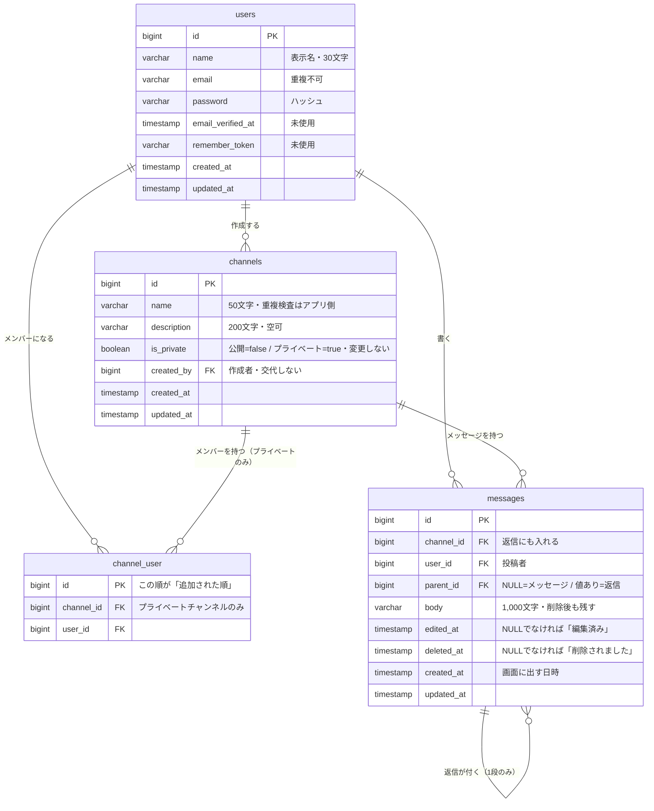

# データ設計（ER図・テーブル定義書・CRUD表）

- 対象: チームチャットアプリ
- 典拠: `docs/spec.md`、`mockup/`（画面見本9枚・`design-guide.md`）、`docs/design/features.md`・`questions.md`・`screens.md`
- 動かす環境: MySQL 8.4（Laravel Sail）・文字コードは `utf8mb4`。セッションはファイル（`SESSION_DRIVER=file`）なのでセッション用のテーブルは作りません
- この文書は「**データをどう持つか**」だけを書きます。URLと権限の線引きは `permissions-api.md`、処理の流れと例外方針は `behavior.md` に分けます
- **削除したメッセージの持ち方は `questions.md` の決定1（案1）に従います。**行を残して `deleted_at` を立て、`body` はそのまま残します
- 仕様書・モックアップ・`docs/design/` に根拠がないものは足していません。**埋まらなかった列と行は 4章にまとめて挙げてあります**

---

## 1. ER図

### 1-1. 図

### 1-2. 関係の読み方

| 関係 | 多重度 | 意味 | 典拠 |
|:--|:--|:--|:--|
| users → channels | 1人が複数作る | チャンネルには作成者が1人いる。あとから交代しない | 仕様書 3-2 / 回答4 |
| users → channel_user | 1人が複数に入る | 人は複数のプライベートチャンネルのメンバーになれる | 仕様書 3-3 |
| channels → channel_user | 1チャンネルに複数人 | **プライベートチャンネルだけ**行を持つ | 仕様書 3-3 / 下記 1-3 |
| users → messages | 1人が複数書く | メッセージ・返信ともに投稿者が1人 | 仕様書 3-4 |
| channels → messages | 1チャンネルに複数件 | 返信も、親と同じチャンネルの行として持つ | 仕様書 3-4 / 下記 1-3 |
| messages → messages | 1件に複数の返信 | `parent_id` で自己参照。**1段のみ** | 回答8 |

### 1-3. この設計で決めたこと

4つはデータの形が分かれるところなので、決めた内容と理由を残します。

| # | 決めたこと | 理由 | 典拠 |
|:--|:--|:--|:--|
| 1 | **返信をメッセージと同じ `messages` テーブルで持つ**（`parent_id` で自己参照） | 返信もメッセージと同じ編集・削除・「編集済み」「削除されました」の扱いなので、仕組みを1つで済ませられる。検索も1テーブルで足りる。別テーブルにすると、これらを2つぶん作ることになる | Q-25 の想定 / Q-28 の想定 / 回答8 |
| 2 | **`channel_user` はプライベートチャンネルだけ行を作る** | 公開チャンネルはログインした社員なら誰でも読み書きできるので、メンバーという状態を持つ意味がない。`channel_user` を「プライベートチャンネルを見られる人」の表と定める。`members.html` はプライベート専用の画面なので、画面への影響はない | 仕様書 3-2・3-3 / `members.html` |
| 3 | **返信にも `channel_id` を入れる**（親と重複して持つ） | 検索は「その人が見られるチャンネル」で絞る必要があり、返信も検索対象なので、毎回親をたどらずに済む。チャンネル削除の連鎖も1本の外部キーで効く。「返信の `channel_id` は親と同じ」はアプリ側で守る | 仕様書 3-6 / Q-28 の想定 / 回答2 |
| 4 | **`messages.body` は NOT NULL**（削除後も本文が入る） | 決定1（案1）の帰結。論理削除しても本文を残すので、NULL になる状態がない | `questions.md` 決定1 |

**持たないことにしたもの**

| 持たないもの | 理由 | 典拠 |
|:--|:--|:--|
| 返信件数のカウンタ列 | 1チャンネル10件前後が前提なので、そのたびに数えれば足りる | 仕様書 5-4 / Q-16 |
| アバターの色の列 | 利用者ごとに4色を**機械的に割り当てる**ので、保存せず算出する | Q-36 の想定 / `design-guide.md` 1 |
| 「追加した人」「外した人」などの操作履歴 | 画面にも仕様書にも出てこない。操作履歴の閲覧はスコープ外 | `features.md` 2-3 |
| 検索履歴のテーブル | 作らないと決めている | `features.md` 2-3 / Q-27 |
| 公開チャンネルへの参加状態 | 公開チャンネルは参加という状態を持たない | Q-06 の想定 |
| 操作が済んだ知らせの置き場 | flash はセッション（`SESSION_DRIVER=file`）に載るので、**テーブルは要りません** | 決定12（仮）/ `behavior.md` 4-6 |

---

## 2. テーブル定義書

### 2-1. `users`（社員・アカウント）

Laravel 標準の `users` テーブルを流用します。

| 列 | 型 | NULL | 既定 | 内容 | 典拠 |
|:--|:--|:--|:--|:--|:--|
| `id` | bigint unsigned | — | 連番 | 主キー | — |
| `name` | varchar(30) | 不可 | — | **表示名。**同姓同名がありうるので重複を許す | 仕様書 5-1 / Q-02 の想定 |
| `email` | varchar(255) | 不可 | — | メールアドレス。**重複不可**（一意制約） | 仕様書 3-1 / Q-02 の想定 |
| `password` | varchar(255) | 不可 | — | ハッシュ化したパスワード。8文字以上はアプリ側で検査 | 仕様書 3-1・5-1 |
| `email_verified_at` | timestamp | 可 | NULL | **未使用。**メールアドレスの確認は挟まない | 回答12 |
| `remember_token` | varchar(100) | 可 | NULL | **未使用。**「ログイン状態を保つ」の指定がない | — |
| `created_at` / `updated_at` | timestamp | 可 | NULL | 作成・更新日時 | — |

- `name` を仕様書どおり30文字の列にしています。Laravel 標準は `varchar(255)` なので、マイグレーションで縮めます（上限が列に出ていると、あとから読む人が仕様と突き合わせられるため）
- 表示名・メールアドレス・パスワードを変える画面は作りません。**この表の行は作られたあと更新されません**（→ 4章・回答13 / Q-05）
- 認証に Laravel Fortify を使いますが、**この表に列は足しません**。Fortify の2要素認証の列を足すマイグレーションは publish しません（2要素認証は作らないため・`permissions-api.md` 2-4・4-3 の #13）

### 2-2. `channels`（チャンネル）

| 列 | 型 | NULL | 既定 | 内容 | 典拠 |
|:--|:--|:--|:--|:--|:--|
| `id` | bigint unsigned | — | 連番 | 主キー | — |
| `name` | varchar(50) | 不可 | — | チャンネル名。**一意制約は張りません**（→ 4章） | 仕様書 5-1 / 回答3 / Q-38 |
| `description` | varchar(200) | 可 | NULL | 説明。空でも作れる | 仕様書 5-1 / `screens.md` 3-5 |
| `is_private` | boolean | 不可 | — | 公開範囲。`false`=公開 / `true`=プライベート。**作成後は変更しない** | 仕様書 3-2 / Q-09 の想定 |
| `created_by` | bigint unsigned | 不可 | — | 作成者（`users.id`）。**交代しない** | 仕様書 3-2 / 回答4 |
| `created_at` / `updated_at` | timestamp | 可 | NULL | 作成・更新日時 | — |

- `is_private` に既定値を置きません。作成時に必ず決まる値だからです（画面の既定が「公開」であることは `screens.md` 3-5 に書いてあります）
- 公開範囲を変える画面がないので、`is_private` は作成後に更新されません（Q-09 / `channel-edit.html`）
- 「作成者だけが編集・削除・メンバー管理できる」は `created_by` との突き合わせで判定します。線引きは `permissions-api.md`（仕様書 3-2）

### 2-3. `channel_user`（プライベートチャンネルのメンバー）

**プライベートチャンネルだけ行を持ちます**（1-3 の決定2）。表の名前は Laravel の既定に合わせています（下の「名前の決まり」）。

> **名前の決まり**: Laravel は多対多の中間テーブル名を、**両モデル名を単数形にしてアルファベット順につないだ名前**（`Channel` と `User` なら `channel_user`）で探します。この表は素の結合に追加日時が付いただけで、役割や状態を持つ独立した実体ではないので、既定の名前に従います。`belongsToMany` にテーブル名の引数が要りません。
>
> そのぶん、**名前からは「プライベートチャンネルだけ」が読み取れません。**1行の意味は「この人はこのチャンネルを見られる」で、公開・プライベートで変わりません。違いは「どの行を作るか」という決まりの側にあります。その決まりは次の2つで守ります。
>
> - 公開チャンネルを作るときは行を作らない（1-3 の決定2・CRUD表 F-07）
> - 「見られるか」の判定は「公開である **または** この表に行がある」で書く（`permissions-api.md`）

| 列 | 型 | NULL | 既定 | 内容 | 典拠 |
|:--|:--|:--|:--|:--|:--|
| `id` | bigint unsigned | — | 連番 | 主キー。**この順がそのまま「追加された順」になります** | `screens.md` 3-4 |
| `channel_id` | bigint unsigned | 不可 | — | 対象のチャンネル（`channels.id`） | 仕様書 3-3 |
| `user_id` | bigint unsigned | 不可 | — | メンバー（`users.id`） | 仕様書 3-3 |

- **日時の列を持ちません**（`created_at`・`updated_at` のどちらも）。メンバー一覧の並びは「作成者を先頭にし、あとは `id` の順」で足り、追加された日時を画面に出すところがないためです（`members.html` に出るのは表示名・メールアドレス・作成者の印だけ）。これで `belongsToMany` を既定の素の形（`withTimestamps()` なし）で扱えます
- この表の行は、作られたあと更新されません（→ 4章）
- `(channel_id, user_id)` に一意制約を張ります。同じ人を二重に追加できません（Q-14 の想定・「すでにメンバーです」）
- **作成者の行も作ります。**プライベートチャンネルを作った時点で、作成者を1行入れます（仕様書 3-2）
- 作成者の行は外せません。チャンネルの作成者本人からも外せません（回答4 / `members.html`）
- 行を消しても、その人が過去に書いたメッセージ・返信は残ります（`messages` には触りません・Q-15 の想定）。**ただし本人も、それを編集・削除できなくなります**（そのチャンネルを見られなくなるため・仕様書 3-3 / `permissions-api.md` 1-4 の △3）

### 2-4. `messages`（メッセージと返信）

メッセージと返信の両方をこの1つのテーブルで持ちます（1-3 の決定1）。

| 列 | 型 | NULL | 既定 | 内容 | 典拠 |
|:--|:--|:--|:--|:--|:--|
| `id` | bigint unsigned | — | 連番 | 主キー | — |
| `channel_id` | bigint unsigned | 不可 | — | 所属するチャンネル（`channels.id`）。**返信にも入れる** | 仕様書 3-4 / 1-3 の決定3 |
| `user_id` | bigint unsigned | 不可 | — | 投稿者（`users.id`） | 仕様書 3-4 |
| `parent_id` | bigint unsigned | 可 | NULL | **NULL ならメッセージ、値が入っていれば返信**（`messages.id`） | 仕様書 3-5 / 回答8 |
| `body` | varchar(1000) | **不可** | — | 本文。**削除しても残します**（決定1・案1） | 仕様書 5-1 / `questions.md` 決定1 |
| `edited_at` | timestamp | 可 | NULL | **NULL でなければ「編集済み」を出す。**値そのものは画面に出しません | 仕様書 3-4 / Q-17 の想定 |
| `deleted_at` | timestamp | 可 | NULL | **NULL でなければ「このメッセージは削除されました」を出す。**Laravel の `SoftDeletes` が使う列 | 仕様書 3-4 / `questions.md` 決定1 |
| `created_at` | timestamp | 可 | NULL | 投稿日時。**画面に出すのはこの値です**（編集しても変えません） | Q-17 の想定 / `design-guide.md` 2 |
| `updated_at` | timestamp | 可 | NULL | 更新日時。画面には出しません | — |

- `body` を `varchar(1000)` にしているのは、仕様書の上限が列に出ているほうが読みやすいためです。改行を含んだ本文もこの型で持てます（仕様書 5-1 / Q-20 の想定）
- **`edited_at` を別に持つ理由**: `updated_at` は削除（`deleted_at` を立てる更新）でも動くので、「編集済み」の判定には使えません。真偽値1つでも足りますが、列が1本で済むので日時で持ちます
- 「編集済み」の印は、一度付いたら消えません（回答5）
- 削除されたメッセージは編集・再削除ができません。返信は続けられます（Q-19 の想定 / 回答6）
- 返信件数は、削除済みの親・子を含めて数えます（`SoftDeletes` の既定から外して数える・Q-23 の想定 / `design-guide.md` 4）
- チャンネルのメッセージ一覧は `parent_id` が NULL の行だけを古い順に並べます（仕様書 3-5 / 回答7）

### 2-5. 索引と外部キー

**索引**

| テーブル | 索引 | なぜ要るか |
|:--|:--|:--|
| `users` | 一意: `email` | ログインで引く。重複を弾く |
| `channels` | 通常: `name` | チャンネル名の重複検査で引く（一意制約ではありません。→ 4章） |
| `channels` | 通常: `created_by` | 外部キーに必要 |
| `channel_user` | **一意: `(channel_id, user_id)`** | 二重追加を弾く。チャンネルのメンバーを引くのにも効く |
| `channel_user` | 通常: `user_id` | 外部キーに必要。「自分が見られるプライベートチャンネル」を引く |
| `messages` | 通常: `(channel_id, created_at)` | チャンネルのメッセージを古い順に並べる |
| `messages` | 通常: `parent_id` | スレッドの返信を引く。返信件数を数える |
| `messages` | 通常: `user_id` | 外部キーに必要 |
| `messages` | 通常: `deleted_at` | `SoftDeletes` が毎回この列で絞るため |

- `body` には索引を張りません。**決定10（仮）で部分一致に決めた**ので、中間一致（`LIKE '%…%'`）では索引が効きません。前方一致やAND検索に変わったら張り直します（→ 4章）
- データ量は20人・1チャンネル10件前後が前提なので、索引はこれ以上増やしません（仕様書 1・5-4）

**外部キー**

| 外部キー | 参照先 | 消えたとき | 理由 |
|:--|:--|:--|:--|
| `channels.created_by` | `users.id` | **制限**（消せない） | 退会・利用者の停止がスコープ外なので、利用者が消える経路がない |
| `channel_user.channel_id` | `channels.id` | **連鎖削除** | チャンネルを消すとメンバーの情報も消える（回答2 / Q-11） |
| `channel_user.user_id` | `users.id` | **制限** | 同上 |
| `messages.channel_id` | `channels.id` | **連鎖削除** | チャンネルを消すと中のメッセージ・返信も消える（回答2 / Q-11） |
| `messages.user_id` | `users.id` | **制限** | 同上 |
| `messages.parent_id` | `messages.id` | **連鎖削除** | 親が物理削除されるのはチャンネルごと消すときだけで、そのとき返信も消える |

**注意**: `messages` は `SoftDeletes` を使うので、`$channel->delete()` のような書き方では中のメッセージは消えません。チャンネルは物理削除（`forceDelete` か、上の連鎖削除に任せる）にします（`questions.md` 決定1 の申し送り）

### 2-6. 触らないテーブル

Laravel の初期状態に入っていて、**この案件では使わない**ものです。消さずに残しますが、設計には出てきません。

| テーブル | 使わない理由 | 典拠 |
|:--|:--|:--|
| `password_reset_tokens` | パスワード再設定を作らない | `features.md` 2-3 / Q-05 |
| `failed_jobs` | キューを使う処理がない | — |
| `personal_access_tokens` | 公開APIはログインも鍵も要らない | 仕様書 3-7 / Q-30 の想定 |

---

## 3. CRUD表

### 3-1. 表

行は `features.md` のF番号（実装単位）、列はテーブルです。

| F番号 | 機能 | `users` | `channels` | `channel_user` | `messages` |
|:--|:--|:-:|:-:|:-:|:-:|
| F-01 | 新規登録 | **C** | — | — | — |
| F-02 | ログイン | R | — | — | — |
| F-03 | ログアウト | — | — | — | — |
| F-04 | 共通レイアウト | R | R | R | — |
| F-05 | アクセス制御 | — | R | R | R |
| F-06 | チャンネル一覧 | R | R | R | — |
| F-07 | チャンネル作成 | — | R / **C** | **C（Pのみ）** | — |
| F-08 | チャンネル編集 | — | R / **U** | — | — |
| F-09 | チャンネル削除 | — | **D** | **D（連鎖）** | R / **D（連鎖）** |
| F-10 | メンバー一覧 | R | R | R | — |
| F-11 | メンバー追加 | R | R | R / **C** | — |
| F-12 | メンバー削除 | — | R | R / **D** | — |
| F-13 | メッセージ一覧 | R | R | R | R |
| F-14 | メッセージ投稿 | — | R | R | **C** |
| F-15 | メッセージ編集 | — | R | R | R / **U** |
| F-16 | メッセージ削除 | — | R | R | **U（論理削除）** |
| F-17 | 返信件数の表示 | — | — | — | R |
| F-18 | スレッド表示 | R | R | R | R |
| F-19 | 返信投稿 | — | R | R | **C** |
| F-20 | メッセージ検索 | R | R | R | R |
| F-21 | 公開チャンネル一覧API | R | R | — | — |
| F-22 | 公開チャンネルのメッセージ一覧API | R | R | — | R |
| F-23 | 初期データ投入 | **C** | **C** | **C** | **C** |

### 3-2. 凡例と読み方

| 記号 | 意味 |
|:--|:--|
| C | 行を作る |
| C（Pのみ） | **プライベートチャンネルの場合のみ**行を作成（INSERT）する |
| R | 読む |
| U | 更新する |
| D | 行を消す（物理削除） |
| D（連鎖） | 外部キーの連鎖削除で消える。アプリから直接は消さない |
| U（論理削除） | `deleted_at` を立てる更新。**行も本文も残る**（決定1・案1） |
| — | そのテーブルに触らない |
| R / C | 同じ機能の中で両方起きる（例: すでにメンバーかを読んでから追加する） |

- **F-16 メッセージ削除が `U` なのが、決定1（案1）の見えるところです。**メッセージ1件の削除では行も本文も消えません。`messages` に `D` が立つのは F-09（チャンネルごと削除）の連鎖だけです（`questions.md` 決定1 / 回答2）
- `channel_user` の R は、プライベートチャンネルを見られるかどうかの判定です。公開チャンネルしか関わらない操作でも、判定そのものは走ります（1-3 の決定2）
- **F-15・F-16 の `channels`・`channel_user` の R は、「いまもそのチャンネルを見られるか」の判定です。**自分が書いたメッセージかどうかを見る**前に**、こちらを先に見ます。プライベートチャンネルから外された人は、自分が過去に書いたメッセージであっても編集・削除ができません（仕様書 3-3 / Q-15 の想定 / `permissions-api.md` 1-4 の △3）
- F-04・F-05 は画面を持たない共通の仕組みなので、実際にはほかの機能の中で一緒に動きます（`features.md` 1-2）
- F-11 の `users` R は探す相手を見つけるため、F-21・F-22 の `users` R は作成者・投稿者の表示名を返すためです（`members.html` / Q-31 の想定）

### 3-3. 表から分かること

| 見えること | 中身 |
|:--|:--|
| `users` に **U と D がない** | プロフィール編集・パスワード再設定・退会をどれも作らないため（→ 4章） |
| `channel_user` に **U がない** | 行に更新する属性がないため。メンバーは「入れる」か「外す」だけ（→ 4章） |
| `messages` の `D` が連鎖だけ | メッセージ1件の削除は `U`。物理削除はチャンネルごと消すときだけ |
| `channels` だけ C・R・U・D が揃う | 作る・読む・直す・消すが画面として全部あるため |

---

## 4. 埋まらなかった列と行

**黙って埋めずに挙げます。**根拠がないか、根拠どうしがぶつかっているところです。

### 4-1. 行が空になったもの

| 場所 | 中身 | なぜ埋まらないか |
|:--|:--|:--|
| **CRUD表 F-03 ログアウト** | 4つのテーブルすべてが `—` | セッションを捨てるだけで、どのテーブルにも触りません。セッションはファイル（`SESSION_DRIVER=file`）なのでテーブルもありません。「ログイン状態を保つ」を作るなら `users.remember_token` の `U` が立ちますが、**その指定が仕様書・モックアップのどちらにもない**ので空のままにしてあります |

### 4-2. 列が空になったもの

| 場所 | 中身 | なぜ埋まらないか |
|:--|:--|:--|
| **`users` の U** | どの機能からも更新が発生しない | 表示名・メールアドレス・パスワードを変える画面を作らないため（回答13 / Q-05）。**今回はこれで正しい**状態です |
| **`users` の D** | どの機能からも削除が発生しない | 退会も、管理者による利用者の停止も作らないため（`features.md` 2-3 / 仕様書 4） |
| **`channel_user` の U** | どの機能からも更新が発生しない | 行に更新する属性がないため。だから日時の列（`created_at`・`updated_at`）も持っていません（2-3） |
| **`users.email_verified_at`** | 列はあるが使わない | メールアドレスの確認を挟まないため（回答12） |
| **`users.remember_token`** | 列はあるが使わない | 「ログイン状態を保つ」の指定がないため |

`users` の U・D が空であること自体は、スコープの決まりどおりです。ただし **`users` に行を消す道がないので、外部キーはすべて「制限」**にしてあります（2-5）。あとで退会を作るなら、`channels.created_by` をどうするか（作成者がいなくなったチャンネルの扱い）を先に決める必要があります。

### 4-3. 制約として表現できなかったもの

| 決まり | なぜ制約にできないか | どこで守るか |
|:--|:--|:--|
| **チャンネル名の重複を禁じる**（回答3） | 回答1「入っていないプライベートチャンネルは存在自体が分からない状態にしたい」とぶつかります。`name` に一意制約を張ると、見えないはずのチャンネルと名前がぶつかったときに「すでに使われています」と断ることになり、存在が漏れます。`screens.md` 4-4 では**その人が見られるチャンネルの中だけ**で重複を見る形にしたので、**一意制約では表現できません**。**Q-38 が未回答です**。「存在が漏れても名前の重複を完全に避けたい」という回答であれば、`name` を一意制約に変えてここを書き換えます | アプリ側（`screens.md` 4-4） |
| **返信は1段まで**（回答8） | `parent_id` の自己参照では「親が親を持たない」ことを外部キーで表せません | アプリ側（`behavior.md`） |
| **返信の `channel_id` は親と同じ** | 1-3 の決定3で重複して持つことにしたため、一致を制約で縛れません | アプリ側（`behavior.md`） |
| **本文は1,000文字以内**（仕様書 5-1） | `varchar(1000)` で上限は守れますが、**サーバ側の検査と二重**になります。エラー文を出すのはアプリ側です | アプリ側（`screens.md` 4-6） |

### 4-4. 回答待ちのもの（仮で決めたものを含む）

| 決められないこと | 待っている回答 | いま置いている状態 |
|:--|:--|:--|
| `messages.body` の索引（検索の当て方） | **Q-26**（回答待ち）。**決定10（仮）で部分一致として進めます** | 索引を**張りません**（中間一致では効かないため）。全文検索（`FULLTEXT` ＋ ngram）も入れません。**前方一致に変わったら索引を1本、AND検索に変わったら条件の組み立てを直します** |
| 照合順序（大文字小文字の区別） | **Q-26**（回答待ち）。**決定10（仮）で「区別しない」として進めます** | Laravel 標準の `utf8mb4_unicode_ci`（`config/database.php`）のままです。**大文字小文字だけでなく、ひらがなとカタカナ・全角と半角・アクセントの違いも同じ字として扱います**（2026-11-03 に実測。「りりーす」で「リリース」が当たります）。この挙動は決定10 で仕様として受け入れました。**区別することになったら、列の照合順序を変えるマイグレーションが1本増えます** |
| `channels.name` の一意制約 | **Q-38** | 張っていません（4-3） |
| 公開APIの1回の件数と続きの取り方 | **Q-32** | データの持ち方には影響しないので、列は足していません。`permissions-api.md` で扱います |

---

## 5. 実装への申し送り

| 先 | 内容 |
|:--|:--|
| マイグレーション | `users.name` を `varchar(30)` に縮める（Laravel 標準は255） |
| マイグレーション | `channels` → `channel_user` → `messages` の順に作る（外部キーの参照先が先） |
| `behavior.md` | `Message` モデルに `SoftDeletes`。**`deleting` で本文を触る処理は入れない**（決定1・案1） |
| `behavior.md` | メッセージ一覧とスレッドは削除済みを含めて引く。**検索と公開APIは既定（除外）のまま触らない**（決定1の「3つの出口」） |
| `behavior.md` | 返信件数は削除済みの親・子を含めて数える（Q-23） |
| `behavior.md` | 「返信は1段まで」「返信の `channel_id` は親と同じ」をアプリ側で守る（4-3） |
| `behavior.md` | **`MessagePolicy` は、メッセージ自体の判定（本人か・削除済みでないか）より先に `ChannelPolicy@view`（いまもそのチャンネルを見られるか）を通す。**順番を逆にすると、プライベートチャンネルから外された人が自分の過去のメッセージを直せてしまい、403 でチャンネルの存在も漏れる（仕様書 3-3 / `permissions-api.md` 1-5・1-6） |
| `behavior.md` | チャンネル削除は物理削除。`SoftDeletes` の `delete()` では中のメッセージが消えない点に注意（2-5） |
| `permissions-api.md` | 公開APIは返す列を許可リストで持つ。`body`・`deleted_at` を素通ししない（決定1の出口3） |
| 設定 | 日時は日本時間で出すので、アプリのタイムゾーンを `Asia/Tokyo` にする（Q-37 の想定） |
| `acceptance.md` | 「削除しても `deleted_at` が入り、`body` は残る」を確かめる観点を入れる（決定1の歯止め） |
| 初期データ（F-23） | アカウント3つ・チャンネル4つ（公開3・プライベート1）・公開チャンネルに各10件前後。返信が付いたもの2件以上（うち1件は返信3件以上）・編集済み1件以上・削除されました1件以上。**削除されましたのうち1件には返信を付ける**（決定1の出口1のテストを手でも確かめられるようにするため） | 仕様書 5-4 |
