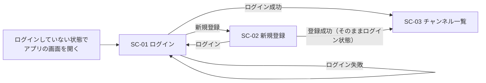
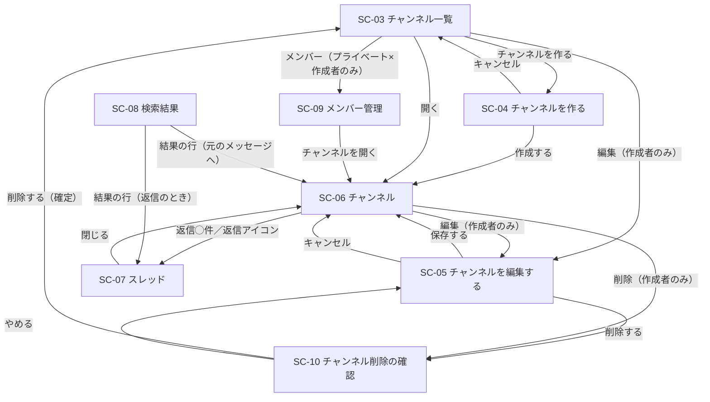
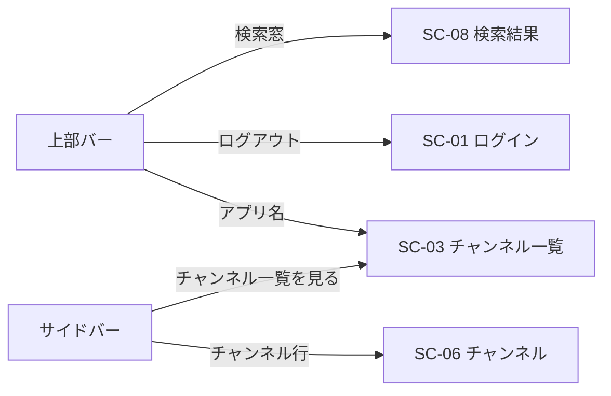

# 画面設計（画面一覧・画面遷移図・画面項目定義・入力チェックとメッセージ）

- 対象: チームチャットアプリ
- 典拠: `mockup/` の画面見本9枚と `mockup/design-guide.md`、`docs/spec.md`、`docs/design/features.md`、`docs/design/questions.md`
- モックアップが最初からあるため、**ワイヤーフレームは描きません**。この文書はモックアップを読み解いて、項目・状態・入力チェックを言葉にしたものです
- **URLとアクセスできる人の線引きは `permissions-api.md`** に分けます。本書は「どの画面に何が出て、何を入れられるか」だけを扱います
- モックアップに無い文言・項目は、`questions.md` の想定（＝まだ回答がないもの）に乗っています。乗っている場所は行ごとに **Q番号** を付け、最後の「6. この設計が前提にしている未確定事項」に一覧しました

---

## 1. 画面一覧

SC番号は**URLを持つ1枚の画面**に振っています。モックアップの `index.html` は見本のカタログページなので、アプリの画面には数えていません。

| SC番号 | 画面名 | モックアップ | 開ける人 | 関係するF番号 | 共通の枠 |
|:--|:--|:--|:--|:--|:--|
| SC-01 | ログイン | `login.html` | 誰でも | F-02 | なし（カード1枚） |
| SC-02 | 新規登録 | `register.html` | 誰でも | F-01 | なし（カード1枚） |
| SC-03 | チャンネル一覧 | `channels.html` | ログイン済み | F-04, F-06 | あり |
| SC-04 | チャンネルを作る | `channel-new.html` | ログイン済み | F-07 | あり |
| SC-05 | チャンネルを編集する | `channel-edit.html`（上半分のカードと赤枠の箱） | そのチャンネルの作成者のみ | F-08, F-09（削除の導線） | あり |
| SC-06 | チャンネル（メッセージ一覧） | `channel-show.html` | そのチャンネルを見られる人 | F-13〜F-17 | あり |
| SC-07 | スレッド | `thread.html` | そのチャンネルを見られる人 | F-18, F-19 | あり（SC-06 の右にパネルが開いた形） |
| SC-08 | 検索結果 | `search.html` | ログイン済み | F-20 | あり |
| SC-09 | メンバー管理 | `members.html` | そのプライベートチャンネルの作成者のみ | F-10〜F-12 | あり |
| SC-10 | チャンネル削除の確認 | `channel-edit.html`（赤枠の確認カード） | そのチャンネルの作成者のみ | F-09 | あり |

「共通の枠」は上部バー（52px固定）と左サイドバー（260px固定）のことです（F-04）。中身は「3-1. 共通部品」にまとめました。

### 1-1. SC-07 を別の画面として数えた理由

モックアップの `thread.html` は「SC-06 の右に 400px のパネルが開いた状態」です。見た目としては SC-06 の一部ですが、**それ自身のURLを持つ画面**として扱います（Q-24 の想定）。ブラウザの「戻る」で閉じられ、スレッドのURLを人に送れるようにするためです。SC-06 と SC-07 の差は「右のパネルがあるか」だけで、左の本文側は同じものを出します。

### 1-2. SC-10 を別の画面として数えた理由

`channel-edit.html` には、編集のカード・赤枠の箱・確認カードが**1ページに並べて**描かれています。ただしそのページの注記は「**※ 見本のため、確認の表示を開いた状態で並べています。**」です。つまりモックアップは「この3つが常に同時に見えている」ことを指定しているのではなく、**切り替わる状態を静的に並べて見せている**ものです（`mockup/README.md` の「切り替えて見せる状態は、静的に開いた状態で描くか、同じページに並べています」と同じ扱い）。

そこで確認カードを、**それ自身のURLを持つ画面 SC-10** として独立させます。

| そうする利点 | 内容 |
|:--|:--|
| 誤操作が減る | 編集のための画面に、確定すると戻せない操作が同居しません。削除に入ったことが画面の切り替わりで分かります |
| 件数を確かめてから出せる | 「メッセージ ◯件と返信 ◯件」はその時点で数える値です。画面を分ければ、開いた瞬間に数えた値を出せます |
| 作りが素直になる | 確認の入力が一致しなかったときの戻り先が、確認画面そのものになります（編集フォームの値を抱えたまま往復しません） |
| SC-06 からの導線が揃う | モックアップでは SC-06 の「削除」も `channel-edit.html` へのリンクですが、押した人の意図は削除です。SC-10 を直接開ければ、編集画面を経由させずに済みます |

**モックアップとの差**: 独立した画面になるぶん、**画面タイトル「チャンネルを削除する」（20px/700）が1つ増えます**。モックアップでは同じ文字列が節見出し（16px/700）として描かれているものを、画面タイトルに上げた形です。確認カードの中身（問い・説明・入力欄・ボタン2つ）は変えません。

SC-05 の赤枠の箱（「このチャンネルを削除します」＋「削除する」ボタン）は SC-05 に残し、**SC-10 への入口**にします。

### 1-3. 画面として数えなかったもの

| もの | 扱い | 理由 |
|:--|:--|:--|
| 上部バー・サイドバー | 全画面の共通部品（F-04） | 単体で開くURLを持たない |
| 検索結果が0件のとき | SC-08 の中の状態 | `search.html` の同じページに並べて描かれている |
| メッセージ1件を消す前の確認 | **未確定**（Q-39） | モックアップに描かれていない。挟むことになっても小さな確認1枚で、画面は増えない見込み |
| 権限がないURLを開いたときの表示 | **未確定**（Q-10 の残り） | モックアップに該当画面がない。「見つかりません」を返す想定だが回答待ちのため、画面として起こさない |
| プロフィール編集・パスワード再設定・退会 | 作らない | `features.md` 2-3（回答13・Q-05） |

---

## 2. 画面遷移図

### 2-1. ログインするまで

- ログインしていない人がアプリの画面を開いたら SC-01 に送ります（公開APIだけがログイン不要・回答9）
- 登録が済んだらそのままログイン状態にして進みます（Q-04 の想定）
- ログイン後の行き先を SC-03 にしています（Q-33 の残り・追加Q-39 の想定）

### 2-2. ログインしたあと

- SC-06 の「削除」ボタンは、モックアップでは `channel-edit.html` へのリンクです。本書ではそれを **SC-10 へ直接**つなぎました（1-2）。SC-05 の赤枠の箱からも SC-10 に入れます。どちらから来ても、確認なしで消える道はありません
- SC-10 で「やめる」を押したときの戻り先は SC-05 です（SC-06 から来た場合も SC-05 に戻します。削除をやめた人の次の用は、名前や説明を直すことだと考えたため）
- SC-05 の「保存する」のあとの行き先は、モックアップの「キャンセル」が SC-06 へ戻ることに合わせて SC-06 にしました（Q-34 の想定）
- 検索結果から元の会話へ飛ぶ線は Q-29 の想定です（モックアップの結果の行はリンクになっていません）

### 2-3. 共通の枠からの遷移（全画面に共通）

モックアップでは上部バーのアプリ名はリンクになっていません。ここだけ `channels.html` への導線として足しています（Q-34 と同じ扱いで未確定）。

---

## 3. 画面項目定義

### 3-0. どこまで書いたか（と、その理由）

`README.md` の決まりどおり、**全画面ぶんは書きません**。`mockup/styles.css` を見ると、9枚の画面は次の4つの部品の組み合わせでできています。

| 部品の系統 | 使っている画面 | 代表に選んだ画面 |
|:--|:--|:--|
| 共通の枠（`.topbar` / `.sidebar`） | SC-03〜SC-10 の8枚 | **3-1. 共通部品** |
| フォームの欄（`.field` / `.label` / `.input` / `.field-foot` / `.count` / `.err`） | SC-01, SC-02, SC-04, SC-05, SC-10 | **SC-02 新規登録** |
| メッセージの一覧と投稿欄（`.msg-list` / `.msg` / `.composer`） | SC-06, SC-07 | **SC-06 チャンネル** |
| 一覧の行（`.rows` / `.row` / `.badge` / `.row__acts`） | SC-03, SC-08, SC-09 | **SC-09 メンバー管理** |

そこで**この4つだけを全項目書き**、残りの6枚は**差分だけ**にしました（3-5）。選んだ基準は次の2つです。

1. **部品の系統を1つずつ代表させる。**同じ系統の画面は、項目の並び方・エラーの出方・無効の見せ方が同じなので、2枚目を書いても同じ表が増えるだけです
2. **その系統でいちばん項目が多い画面を代表にする。**SC-02 は入力欄4つと文字数表示とヘルプ文が全部揃っています。SC-06 は「編集済み」「削除されました」「返信◯件」「ホバー操作」と状態がすべて出ます。SC-09 は「無効（理由つき）」と「badge」が出る唯一の一覧です。少ない側（SC-01・SC-07 など）を差分で書けば、違いだけが残って読みやすくなります

SC-03 と SC-08 を差分にしたのは、行の形が SC-09 と同じ `.row` で、違うのは**行に出す中身と、行の右に出すボタンの出し分け**だけだからです。その出し分けは差分表に書き切れます。

書かなかった画面も「どの表を見ればよいか」を差分表の先頭に書いたので、追えなくなる場所はありません。

### 3-1. 共通部品（上部バー・サイドバー／SC-03〜SC-09 の7枚に共通）

| 位置 | 項目 | 種類 | 内容 | 出どころ・備考 |
|:--|:--|:--|:--|:--|
| 上部バー | ブランド | 記号＋文字 | 角丸4pxの記号「チ」＋「チームチャットアプリ」 | アプリ名は全画面この表記で統一（仕様書 5-3） |
| 上部バー | 検索窓 | 入力欄（リンク） | プレースホルダ「メッセージを検索」。虫めがねのアイコン付き | 押すと SC-08 へ。キーワードを入れて確定すると検索（F-20） |
| 上部バー | ログイン中の氏名 | 文字 | ログインしている人の表示名 | 色は `--side-text-strong` |
| 上部バー | ログアウト | リンク | 「ログアウト」 | F-03 |
| サイドバー | グループ見出し | 文字 | 「チャンネル」（11px/700） | `design-guide.md` 2 |
| サイドバー | チャンネル行 | リンクの繰り返し | 記号＋チャンネル名。公開は `#`、プライベートは鍵のアイコン | **出すのは「公開チャンネル全部＋自分がメンバーのプライベートチャンネル」**（Q-06 の想定）。メンバーでないプライベートチャンネルは名前も出しません（回答1） |
| サイドバー | 選択中の強調 | 状態 | いま開いているチャンネルの行を地 `#234B80`・文字白・太さ500 | `design-guide.md` 4。SC-05・SC-09 でも、対象のチャンネルの行を選択中にします（モックアップのとおり） |
| サイドバー | チャンネル一覧を見る | リンク | 「チャンネル一覧を見る」（最下部） | SC-03 へ |
| 本文の上 | 操作が済んだ知らせ | 1行の帯 | 例「チャンネルを作成しました」 | **未確定（Q-34）。**モックアップに見本がありません |

- 並び順: チャンネル行は作成された順（Q-06 の想定）
- 件数が増えてもサイドバーは折りたたみません（Q-06 の想定）
- アバターは表示名の先頭2文字＋人ごとに固定の4色（Q-36 の想定）。1文字の表示名は1文字だけ出します

### 3-2. SC-02 新規登録

カード幅 420px（`--form-max`）。上部バー・サイドバーはありません。

| 順 | 項目 | 種類 | 初期値 | 必須 | 制限 | 補助の表示 |
|:--|:--|:--|:--|:--|:--|:--|
| 1 | ブランド | 記号＋文字 | 「チ」＋チームチャットアプリ | — | — | — |
| 2 | 見出し | 文字 | 「新規登録」（中央・20px/700） | — | — | — |
| 3 | 表示名 | 1行入力 | 空 | ○（`*` 赤） | 30文字 | 下左にヘルプ「メッセージに表示される名前です。」／下右に文字数 `5 / 30` |
| 4 | メールアドレス | 1行入力 | 空 | ○（`*` 赤） | メール形式・他の人と重複不可（Q-02） | なし |
| 5 | パスワード | 1行入力（伏字） | 空 | ○（`*` 赤） | 8文字以上（上限なし） | 下にヘルプ「8文字以上で入力してください。」 |
| 6 | パスワード（確認用） | 1行入力（伏字） | 空 | ○（`*` 赤） | 5 と一致 | なし（Q-01 の想定） |
| 7 | 登録する | 主ボタン | — | — | — | 高さ44px・横幅いっぱい（`--ctl-h-lg`） |
| 8 | ログインへの導線 | 文字＋リンク | 「すでにアカウントをお持ちの方は ログイン」 | — | — | SC-01 へ |

- 文字数の表示は打つそばから変わる形（`5 / 30`）。上限を超えたら `#B3261E`＋太さ500（Q-21 の想定）
- ヘルプ文は**句点あり**、エラー文は**句点なし**。モックアップがそう書き分けています
- エラーが出たときは、その欄の枠と地が赤に変わり、文字数表示があった場所の**左側にエラー文**が入ります（`channel-new.html` の `.field-foot` のとおり）

### 3-3. SC-06 チャンネル（メッセージ一覧）

左から サイドバー → 本文。本文は上から「チャンネルの見出し」「メッセージ一覧（縦スクロール）」「投稿欄（下に固定）」の3段です。

#### チャンネルの見出し

| 項目 | 種類 | 内容 | 出す条件 |
|:--|:--|:--|:--|
| 記号＋チャンネル名 | 文字（20px/700） | 公開は `#`、プライベートは鍵 | 常に |
| 公開範囲の印 | badge | 「公開」（藍の薄地）／「プライベート」（注意の薄地） | 常に |
| 説明 | 文字（控えめ） | チャンネルの説明。空なら出さない | 説明があるとき |
| 編集 | 小ボタン | 鉛筆アイコン＋「編集」→ SC-05 | **作成者のみ** |
| 削除 | 小ボタン（赤文字） | ごみ箱アイコン＋「削除」→ SC-05 の削除の確認 | **作成者のみ** |

#### メッセージ一覧

| 項目 | 種類 | 内容 | 備考 |
|:--|:--|:--|:--|
| 日付の区切り | 帯 | 「2026年8月17日（月）」 | 日付が変わる手前に1本。曜日は括弧つき |
| アバター | 円 | 表示名の先頭2文字 | 人ごとに固定の4色（Q-36） |
| 投稿者名 | 文字（13px/500） | 表示名 | 削除されたメッセージでも残す |
| 日時 | 文字（12px・控えめ） | `2026/08/17 09:12` | **書いたときの日時のまま**。編集しても変えません（Q-17 の想定） |
| 本文 | 文字（14px・行間1.8） | メッセージ本文 | 改行はそのまま改行として出す。装飾・自動リンクはなし（Q-20 の想定） |
| 編集済み | 文字（12px・控えめ） | 本文の末尾に半角スペースを空けて「編集済み」 | 一度付いたら消えません（回答5） |
| 削除されました | 破線の枠 | 高さ24px・地 `#FAFBFC` に「このメッセージは削除されました」 | 本文は出さない。投稿者名・日時・返信件数は残す |
| 返信◯件 | リンク（12px） | 「返信3件」＋吹き出しアイコン → SC-07 | 返信が1件以上のときだけ。**削除されたメッセージでも消さない**。削除された返信も件数に含めます（Q-23 の想定） |
| ホバー操作 | 白い小枠の28pxアイコン3つ | 返信／編集／削除 | 行にマウスを乗せたときだけ。**編集・削除は自分のメッセージにだけ**。削除されたメッセージには編集・削除を出さず、返信だけ残します（Q-19 の残り） |
| 編集中 | 入力欄に差し替え | 本文があった場所が入力欄になり、下に「保存」（塗り）と「やめる」 | まわりのメッセージはそのまま |
| 0件のとき | 空状態の枠 | 見出し「まだメッセージがありません」／下に「最初のメッセージを送ってみましょう」 | **未確定（Q-35）。**モックアップの空状態は検索0件だけ |

- 並びは古いものが上、新しいものが下（回答7）。ページ送りはなく全件を出し、開いたときは一番下が見えている状態（Q-16 の残り）
- 返信はこの一覧には流しません（仕様書 3-5）

#### 投稿欄（下に固定）

| 項目 | 種類 | 内容 | 制限 |
|:--|:--|:--|:--|
| 本文 | 複数行入力 | プレースホルダ「#開発 にメッセージを送る」（`#` ＋そのチャンネル名） | 1,000文字 |
| 文字数 | 文字（12px・控えめ） | `0 / 1,000 文字` | 超過は `#B3261E`＋太さ500（Q-21） |
| 送信 | 主ボタン（小） | 「送信」 | — |

投稿欄は、そのチャンネルに書ける人にだけ出します（F-05）。

### 3-4. SC-09 メンバー管理

プライベートチャンネルの作成者だけが開けます。

| 位置 | 項目 | 種類 | 内容 | 備考 |
|:--|:--|:--|:--|:--|
| 見出し | 鍵＋チャンネル名＋badge | 文字（20px/700） | 「採用プロジェクト」＋「プライベート」 | 公開チャンネルにこの画面はありません |
| 見出し | 補足 | 文字（12px・控えめ） | 「（説明）　·　追加された人だけが読み書きできます。」 | 説明と固定文を中黒でつなぐ |
| 見出し | チャンネルを開く | 小ボタン | → SC-06 | — |
| 追加カード | 見出し | 文字（16px/700） | 「メンバーを追加する」 | — |
| 追加カード | 探す欄 | 1行入力 | プレースホルダ「表示名またはメールアドレスで探す」 | **ぴたり一致する社員を1人だけ**追加（Q-14 の想定）。打ちながら候補は出しません |
| 追加カード | 追加 | 主ボタン | ＋アイコン＋「追加」 | — |
| 一覧 | 見出し | 文字（16px/700） | 「メンバー　◯人」 | 人数は中の行数と一致させる |
| 一覧の行 | アバター | 円 | 先頭2文字 | — |
| 一覧の行 | 表示名 | 文字 | 表示名 | — |
| 一覧の行 | 作成者の印 | badge | 「作成者」 | 作成者の行だけ |
| 一覧の行 | メールアドレス | 文字（12px・控えめ） | `sato@example.com` | — |
| 一覧の行 | 外す | 小ボタン（赤文字） | 「外す」 | 作成者の行は**押せない状態**にし、左に12pxで「作成者は外せません」を添える（回答4／`design-guide.md` 4）。非表示にはしません |

- 並び順: 作成者を先頭にし、あとは追加された順（モックアップの並びに合わせた想定）
- 外された人が過去に書いたメッセージ・返信はそのまま残ります（Q-15 の想定）

### 3-5. 残り6枚の差分

#### SC-01 ログイン ← 3-2（SC-02）と同じ形

| 違い | 内容 |
|:--|:--|
| 見出し | 「ログイン」 |
| 入力欄 | **メールアドレス**と**パスワード**の2つだけ。`*` の必須印・ヘルプ文・文字数表示はありません |
| ボタン | 「ログイン」（高さ44px・横幅いっぱい） |
| 下の導線 | 「アカウントをお持ちでない方は 新規登録」→ SC-02 |
| エラー | パスワード欄の下に1文だけ（4-2 参照）。どちらの欄が違うかは出しません |
| ないもの | 「パスワードをお忘れの方」の導線（`features.md` 2-3・Q-05） |

#### SC-04 チャンネルを作る ← 3-2（SC-02）と同じフォームの形。幅680px・カード1枚

| 順 | 項目 | 種類 | 必須 | 制限 | 補助の表示 |
|:--|:--|:--|:--|:--|:--|
| 1 | チャンネル名 | 1行入力 | ○ | 50文字 | 下右に `0 / 50` |
| 2 | 説明 | 複数行入力 | — | 200文字 | 下左にヘルプ「何について話す場所かを短く書きます。」／下右に `8 / 200` |
| 3 | 公開範囲 | 選択肢2つ（縦並び） | ○（既定は「公開」） | — | 見出し「公開範囲」 |
| 4 | キャンセル / 作成する | ボタン2つ（右寄せ） | — | — | 「作成する」だけ塗り |

公開範囲の選択肢は、題と説明文の2段です。

| 選択肢 | 題 | 説明文 |
|:--|:--|:--|
| 公開 | 公開 | ログインしている社員なら誰でも読み書きできます。 |
| プライベート | プライベート | 追加された人だけが読み書きできます。作成者がメンバーを管理します。 |

選んでいる側は枠 `#2B5C9B`・地 `#EEF3F9`（`design-guide.md` 4）。作った人はそのままメンバーになります（仕様書 3-2）。

#### SC-05 チャンネルを編集する ← SC-04 と同じフォーム。幅680px

| 違い | 内容 |
|:--|:--|
| 見出し | 「チャンネルを編集する」 |
| 初期値 | いまのチャンネル名・説明が入った状態 |
| 公開範囲 | **欄そのものがありません。**代わりにチャンネル名の下にヘルプ「公開チャンネルです。公開範囲はあとから変更できません。」（プライベートなら「プライベートチャンネルです。公開範囲はあとから変更できません。」と読み替え） |
| ボタン | 「キャンセル」→ SC-06 ／「保存する」 |
| 足される節 | 「チャンネルを削除する」（16px/700）＋赤枠の箱 |

削除の節（下半分・SC-10 への入口）:

| 項目 | 種類 | 内容 |
|:--|:--|:--|
| 節見出し | 文字（16px/700） | 「チャンネルを削除する」 |
| 箱 | 赤枠の箱（`.danger-box`） | 中に次の3つを横並びで入れる |
| 見出し | 文字（13px/500・赤） | 「このチャンネルを削除します」 |
| 影響の説明 | 文字（12px・控えめ） | 「メッセージと返信もすべて削除され、元に戻せません。」 |
| 削除する | ボタン（赤文字） | **SC-10 へ移動**（この画面では消えません） |

ここに確認カードは出しません（1-2）。確認の中身は次の SC-10 です。

#### SC-10 チャンネル削除の確認 ← SC-05 と同じ幅680px・カード1枚

共通の枠はあり。サイドバーは対象のチャンネルの行を選択中にします。カードの枠は赤（`--danger-line`）で、`design-guide.md` 4 の「削除の確認」の決まりに従います。

| 順 | 項目 | 種類 | 内容 | 備考 |
|:--|:--|:--|:--|:--|
| 1 | 画面タイトル | 文字（20px/700） | 「チャンネルを削除する」 | **モックアップでは節見出し（16px/700）。画面になるぶん1段上げたもの（1-2）** |
| 2 | 問い | 文字（16px/700） | 「「開発」を削除しますか？」 | チャンネル名を差し込む。記号（`#`／鍵）は付けません（モックアップのとおり） |
| 3 | 影響の説明 | 文字（14px・控えめ） | 「メッセージ ◯件と返信 ◯件も削除されます。この操作は取り消せません。確認のためチャンネル名を入力してください。」 | 件数は「返信でないメッセージ」と「返信」を別々に数え、「削除されました」になっているものも含めます（Q-12 の残り）。**この画面を開いた時点で数えた値**を出します |
| 4 | 確認の入力欄 | 1行入力（幅280px） | 空。プレースホルダは**チャンネル名そのもの** | 一字一句の一致を求めます（4-5） |
| 5 | やめる | ボタン（枠だけ） | 「やめる」 | → SC-05。何も消しません |
| 6 | 削除する | ボタン（**塗りの赤** `#B3261E`） | 「削除する」 | 右寄せで 5 の右。確定すると → SC-03 |

- 5 と 6 は右寄せで横並び（`.inline-2`）。塗りは 6 だけです
- 確定したあとは SC-03 に移り、上部に知らせを1行出します（例「チャンネルを削除しました」。**未確定・Q-34**）
- 消えるのは、そのチャンネルと中のメッセージ・返信・メンバーの情報です。跡は残りません（回答2・Q-11）
- 作成者以外がこの画面のURLを開いても出しません（F-05。返し方は **Q-10 の残りで未確定**）

#### SC-07 スレッド ← 3-3（SC-06）に右のパネルを足した形

左の本文側（見出し・メッセージ一覧・投稿欄）は SC-06 と同じものを出します。右に 400px 固定のパネルが開きます。

| 位置 | 項目 | 種類 | 内容 |
|:--|:--|:--|:--|
| パネルの頭 | 題 | 文字（13px/500） | 「スレッド」 |
| パネルの頭 | 所属 | 文字（12px・控えめ） | 記号＋チャンネル名 |
| パネルの頭 | 閉じる | 28pxアイコンボタン | × → SC-06 |
| パネルの中 | 元のメッセージ | メッセージ1件 | SC-06 と同じ出し方。**削除されていても出します**（跡地の枠＋投稿者名＋日時） |
| パネルの中 | 返信件数 | 文字（控えめ） | 「返信3件」（元のメッセージと返信の間の区切り） |
| パネルの中 | 返信 | メッセージの繰り返し | SC-06 と同じ出し方。自分の返信は編集・削除ができます（Q-25 の想定） |
| パネルの足 | 返信の投稿欄 | 複数行入力＋文字数＋送信 | プレースホルダは「**返信を送る**」。1,000文字 |

- 返信に返信ボタンは出しません（回答8。返信は1段まで）
- 削除されたメッセージにも返信を続けられます（回答6）。投稿欄は出したままです

#### SC-03 チャンネル一覧 ← 3-4（SC-09）と同じ行の形

| 位置 | 項目 | 内容 |
|:--|:--|:--|
| 見出し | 題 | 「チャンネル一覧」（20px/700） |
| 見出し | 補足 | 「公開チャンネルは、ログインしている社員なら誰でも読み書きできます。」 |
| 見出し | チャンネルを作る | 主ボタン（＋アイコン）→ SC-04 |
| 行 | 題 | 記号（`#`／鍵）＋チャンネル名＋公開範囲の badge |
| 行 | 副題 | 「（説明）　·　作成者：鈴木 花子」（中黒でつなぐ） |
| 行 | ボタン | 右端に小ボタンを**条件つきで**並べる（下表） |
| 0件のとき | 空状態の枠 | 「まだチャンネルがありません」／「チャンネルを作って会話を始めましょう」（**未確定・Q-35**） |

ボタンの出し分け（並びは左から この順）:

| ボタン | 出す条件 | 行き先 |
|:--|:--|:--|
| メンバー | **プライベート**かつ**自分が作成者** | SC-09 |
| 編集 | **自分が作成者** | SC-05 |
| 開く | 常に | SC-06 |

出す行は「公開チャンネル全部＋自分がメンバーのプライベートチャンネル」です。メンバーでないプライベートチャンネルは行を出しません（回答1）。アバターは出しません。

#### SC-08 検索結果 ← 3-4（SC-09）と同じ行の形

| 位置 | 項目 | 内容 |
|:--|:--|:--|
| 見出し | 題 | 「メッセージを検索」（20px/700） |
| 検索の欄 | キーワード＋検索 | 1行入力（幅560px）＋主ボタン「検索」。入力したキーワードは入れたまま残す |
| 件数 | 文字（12px・控えめ） | 「「リリース」の検索結果　3件」 |
| 行 | 上段のメタ | 「記号＋チャンネル名　·　投稿者の表示名　·　2026/08/17 09:12」（中黒区切り。プライベートは鍵のアイコン） |
| 行 | 下段の本文 | 本文を前後含めて100文字ほどで切り、**一致した部分を `#FBEBBD` で強調**（`mark`） |
| 0件のとき | 空状態の枠 | 見出し「「議事録」に一致するメッセージはありません」／下に「別のキーワードで試すか、キーワードを短くしてください。」 |

- 出るのは**自分が見られるチャンネルのメッセージだけ**です（仕様書 3-6）。行にボタンは置かず、行そのものを押して元の会話へ移動します（Q-29 の想定）
- 探す対象は本文だけ（回答10）。返信も対象に含め、削除されたメッセージは出しません（Q-28 の想定）
- 並びは新しい順・上から50件まで（Q-27 の残り）

---

## 4. 入力チェックとエラーメッセージ

### 4-1. 全体の決まり

| 決まり | 内容 | 出どころ |
|:--|:--|:--|
| 出す場所 | その**入力欄の下**。欄の枠を `#B3261E`・地を `#FCEFEE`・フォーカスリングを赤（`rgba(179,38,30,.2)`）に変える | `design-guide.md` 4 |
| 見た目 | 12px の赤文字。文頭に赤い丸の `!` | `design-guide.md` 4 |
| 言い回し | **1文・句点なし。**例「チャンネル名を入力してください」 | `design-guide.md` 4 |
| 文字数表示との同居 | 欄の下は左にエラー文・右に文字数（`channel-new.html` の形） | `channel-new.html` |
| 入力値 | エラーのときも、打った内容は消さずに残す（パスワードの欄を除く） | — |
| 検査する場所 | **必ずサーバ側で検査します。**画面の文字数表示は打ちやすさのための補助で、上限を超えたまま送られてもサーバで弾きます | Q-21 の想定 |
| 空の扱い | 送られてきた値は、**前後の空白と改行を取り除いてから**空かどうかを見ます。取り除いた結果が空なら、必須のエラーにします（空白だけ・改行だけを送っても通りません） | 仕様書 5-1 の「空のままの送信」 |
| 取り除く範囲 | 取り除くのは**前後だけ**です。本文の途中の改行・空白はそのまま残します（改行はそのまま表示するため・Q-20 の想定） | — |
| 文字数の数え方 | 上限も、**前後の空白と改行を取り除いたあと**の文字数で数えます。保存するのも取り除いたあとの値です | 仕様書 5-1 |

### 4-2. SC-01 ログイン

| 項目 | チェック | エラー文 | 出どころ |
|:--|:--|:--|:--|
| メールアドレス | 空でない | メールアドレスを入力してください | `design-guide.md` 4 の型 |
| パスワード | 空でない | パスワードを入力してください | 同上 |
| 組み合わせ | 一致するアカウントがある | **メールアドレスまたはパスワードが正しくありません** | `login.html`（原文のまま） |

組み合わせのエラーは**パスワード欄の下**に出し、どちらが違うかは明かしません（Q-03 の想定）。

### 4-3. SC-02 新規登録

| 項目 | チェック | エラー文 | 出どころ |
|:--|:--|:--|:--|
| 表示名 | 空でない | 表示名を入力してください | 型 |
| 表示名 | 30文字以内 | 表示名は30文字以内で入力してください | 仕様書 5-1 |
| メールアドレス | 空でない | メールアドレスを入力してください | 型 |
| メールアドレス | メールの形 | メールアドレスの形式が正しくありません | 型 |
| メールアドレス | ほかの人が使っていない | このメールアドレスはすでに使われています | **Q-02 の想定** |
| パスワード | 空でない | パスワードを入力してください | 型 |
| パスワード | 8文字以上 | パスワードは8文字以上で入力してください | 仕様書 5-1（ヘルプ文「8文字以上で入力してください。」に合わせた言い回し） |
| パスワード（確認用） | 空でない | パスワード（確認用）を入力してください | 型 |
| パスワード（確認用） | パスワードと一致 | **パスワードが一致しません** | `questions.md` Q-01 の想定 |

表示名の重複は許します（同姓同名がありうるため・Q-02 の想定）。招待コードや承認は挟みません（回答12）。

### 4-4. SC-04 チャンネルを作る／SC-05 チャンネルを編集する

| 項目 | チェック | エラー文 | 出どころ |
|:--|:--|:--|:--|
| チャンネル名 | 空でない | **チャンネル名を入力してください** | `channel-new.html`（原文のまま） |
| チャンネル名 | 50文字以内 | チャンネル名は50文字以内で入力してください | 仕様書 5-1 |
| チャンネル名 | 同じ名前がない | この名前のチャンネルはすでにあります | 回答3（文言は型から作成） |
| 説明 | 200文字以内 | 説明は200文字以内で入力してください | 仕様書 5-1 |
| 公開範囲（SC-04 のみ） | どちらかを選んでいる | 公開範囲を選択してください | 型（既定が「公開」なので通常は出ません） |

- 名前の重複を見る範囲は、**その人が見られるチャンネルの中だけ**です（公開チャンネル全部＋自分がメンバーのプライベートチャンネル）。見えないプライベートチャンネルと名前がぶつかっても、そのまま作れます。存在を隠すこと（回答1）を、名前の重複を禁じること（回答3）より優先した判断で、**Q-38 で確認中**です
- SC-05 では、自分自身は重複の相手に数えません（名前を変えずに説明だけ直せるようにするため）
- SC-05 に公開範囲の欄はないので、送られてきても無視します（Q-09 の想定）

### 4-5. SC-10 チャンネル削除の確認

| 項目 | チェック | エラー文 | 出どころ |
|:--|:--|:--|:--|
| 確認の入力欄 | 空でない | チャンネル名を入力してください | 型 |
| 確認の入力欄 | チャンネル名と一字一句一致 | チャンネル名が一致しません | 型（`channel-edit.html` の「確認のためチャンネル名を入力してください。」に対応） |

一致するまで「削除する」は押せても確定しません（Q-12 の残り。モックアップの強さに合わせています）。エラーのときは SC-10 にとどまり、確認の入力欄の下にエラー文を出します（SC-05 には戻しません）。

### 4-6. SC-06 メッセージの投稿・その場で書き換える／SC-07 返信の投稿・その場で書き換える

「その場で書き換える」は、本文があった場所が入力欄に変わる形の編集です（`design-guide.md` 4 の「編集中（メッセージ）」・F-15）。別の画面もダイアログも使いません。**新しく書くときと同じチェックを、同じ数だけ**かけます。

| 場面 | 入力する場所 | 項目 | チェック | エラー文 | 出どころ |
|:--|:--|:--|:--|:--|:--|
| 新しく投稿する | SC-06 の投稿欄 | 本文 | 空でない | メッセージを入力してください | 型 |
| 新しく投稿する | SC-06 の投稿欄 | 本文 | 1,000文字以内 | メッセージは1,000文字以内で入力してください | 仕様書 5-1 |
| その場で書き換える | SC-06 のメッセージ（編集中の入力欄） | 本文 | 空でない | メッセージを入力してください | 型 |
| その場で書き換える | SC-06 のメッセージ（編集中の入力欄） | 本文 | 1,000文字以内 | メッセージは1,000文字以内で入力してください | 仕様書 5-1 |
| 新しく返信する | SC-07 の投稿欄 | 本文 | 空でない | メッセージを入力してください | 型 |
| 新しく返信する | SC-07 の投稿欄 | 本文 | 1,000文字以内 | メッセージは1,000文字以内で入力してください | 仕様書 5-1 |
| その場で書き換える | SC-07 の返信（編集中の入力欄） | 本文 | 空でない | メッセージを入力してください | 型 |
| その場で書き換える | SC-07 の返信（編集中の入力欄） | 本文 | 1,000文字以内 | メッセージは1,000文字以内で入力してください | 仕様書 5-1 |

- 上限の `1,000` は三桁区切りで書きます（投稿欄の `0 / 1,000 文字` の表記に合わせたもの）
- 空かどうかは、前後の空白と改行を取り除いたあとで見ます（4-1）。**書き換えて空にして保存しても、削除にはなりません。**エラーにして編集中のまま残します（消すときはごみ箱を使います）
- エラー文を出す場所: 新しく書くときは投稿欄の下（文字数表示の左）。その場で書き換えるときは入力欄の下・「保存」「やめる」の上
- 書き換えをやめたときは、元の本文に戻します（何も保存しません）
- 返信もメッセージと同じチェックです（Q-25 の想定）
- 書き換えても日時は書いたときのままで、末尾に「編集済み」が付きます（Q-17 の想定・回答5）

### 4-7. SC-09 メンバー追加

| 項目 | チェック | エラー文 | 出どころ |
|:--|:--|:--|:--|
| 探す欄 | 空でない | 表示名またはメールアドレスを入力してください | 型（プレースホルダに合わせた言い回し） |
| 探す欄 | 一致する社員がいる | 該当する社員が見つかりません | **Q-14 の想定** |
| 探す欄 | 一致が1人に絞れる | 同じ表示名の社員が複数いるためメールアドレスで指定してください | **Q-14 の想定** |
| 探す欄 | まだメンバーでない | この社員はすでにメンバーです | **Q-14 の想定** |

エラー文は探す欄の下に出します（カードの中）。

### 4-8. SC-08 検索

| 項目 | チェック | エラー文 | 出どころ |
|:--|:--|:--|:--|
| キーワード | 空でない | キーワードを入力してください | 型（モックアップに文言がないため作成） |

- 0件は**エラーではありません。**空状態の枠で「「◯◯」に一致するメッセージはありません」と出します（`search.html`）
- 当て方（部分一致でよいか・大文字小文字・スペース区切り）は **Q-26 の残りで未確定**です

### 4-9. 操作できないときの見せ方（入力チェックではないもの）

| 場面 | 見せ方 | 出どころ |
|:--|:--|:--|
| 他人のメッセージ | ホバー操作に編集・削除を**出さない** | `design-guide.md` 4 |
| 他人のチャンネル | 見出しに編集・削除を**出さない**／一覧の行に編集・メンバーを**出さない** | `channels.html` |
| 見られないチャンネルのURLを直接開く | **未確定（Q-10 の残り）。**「見つかりません」を返す想定 | — |

「作成者は外せません」（押せない「外す」ボタン）は、入力の中身ではなく**誰が操作したか**の話なので、この表からは落としました。見せ方は **3-4（SC-09 の項目定義）**に書いてあり、できる／できないの線引きは `permissions-api.md` で決めます。

---

## 5. 言葉づかいの決まり（モックアップから読み取ったもの）

| 決まり | 例 |
|:--|:--|
| ボタンは「◯◯する」 | 登録する／作成する／保存する／削除する／追加する（ボタン文字は「追加」） |
| やめる側は「キャンセル」（フォーム）、「やめる」（確認カード） | `channel-new.html` ／ `channel-edit.html` |
| ヘルプ文・空状態の説明は**句点あり** | 「メッセージに表示される名前です。」 |
| エラー文は**句点なし・1文** | 「チャンネル名を入力してください」 |
| 問いかけは「◯◯しますか？」 | 「「開発」を削除しますか？」 |
| 中黒は全角スペースで囲む | 「採用まわりの進行　·　作成者：佐藤 太郎」 |
| 日時は `2026/08/17 14:32` 固定・日本時間 | `design-guide.md` 2 ／ Q-37 の想定 |
| 日付の区切りは `2026年8月17日（月）` | `channel-show.html` |
| 件数は「◯件」、人数は「◯人」 | 「返信3件」／「メンバー　2人」 |

---

## 6. この設計が前提にしている未確定事項

本書のうち、**モックアップにも仕様書にも根拠がなく、`questions.md` の想定に乗っている**ところです。回答が返ってきたら、まず本書を直します。

| Q | 本書で前提にしたこと | 書いた場所 |
|:--|:--|:--|
| Q-01 | 「パスワード（確認用）」を置き、不一致は「パスワードが一致しません」 | 3-2 / 4-3 |
| Q-02 | メールアドレスは重複不可・表示名は重複可 | 4-3 |
| Q-03 | ログイン失敗は1文だけ出し、どちらが違うかは明かさない | 4-2 |
| Q-04 | 登録後はそのままログイン状態で SC-03 へ | 2-1 |
| Q-06 | サイドバーは公開全部＋自分がメンバーのプライベート、作成順、折りたたみなし | 3-1 |
| Q-09 | SC-05 に公開範囲の欄を置かない | 3-5 / 4-4 |
| Q-10 | 見られないチャンネルのURLは「見つかりません」 | 1-2 / 4-9 |
| Q-12 | 削除の確認はチャンネル名の打ち込み。件数は削除済みも含める。確認を独立した画面（SC-10）にする | 1-2 / 3-5 / 4-5 |
| Q-14 | メンバー追加はぴたり一致で1人。3つのエラー文 | 3-4 / 4-7 |
| Q-15 | 外された人の過去の書き込みは残す | 3-4 |
| Q-16 | ページ送りなし・全件・開いたら一番下 | 3-3 |
| Q-17 | 編集しても日時は書いたときのまま | 3-3 |
| Q-19 | 削除されたメッセージには編集・削除を出さない（返信だけ残す） | 3-3 |
| Q-20 | 改行だけ反映。装飾・自動リンクなし | 3-3 |
| Q-21 | 文字数は入力に追随。超過は赤。サーバでも検査 | 3-2 / 3-3 / 4-1 |
| Q-23 | 返信件数に削除済みを含める | 3-3 |
| Q-24 | SC-07 を別URLの画面として数える | 1-1 |
| Q-25 | 返信もメッセージと同じ編集・削除・チェック | 3-5 / 4-6 |
| Q-26 | 当て方（部分一致・大文字小文字・AND）が未確定 | 4-8 |
| Q-27 | 検索結果は新しい順・50件まで | 3-5 |
| Q-28 | 返信も検索対象。削除済みは出さない | 3-5 |
| Q-29 | 本文は100文字ほどで切り、行を押すと元の会話へ | 3-5 / 2-2 |
| Q-33 | ログイン後の最初の画面は SC-03 | 2-1 |
| Q-34 | 操作が済んだ知らせを移動先の上部に1行。保存後は SC-06 へ | 3-1 / 2-2 |
| Q-35 | 空状態の文言（メッセージ0件・チャンネル0件） | 3-3 / 3-5 |
| Q-36 | アバターは先頭2文字＋人ごとに固定の4色 | 3-1 |
| Q-37 | 日時は日本時間 | 5 |
| Q-38 | 名前の重複は「その人が見られるチャンネルの中だけ」で見る | 4-4 |
| Q-39 | メッセージ1件の削除前の確認は、挟むかどうかが未確定 | 1-2 |

### 6-1. モックアップに文言がなく、型から作ったエラー文

`design-guide.md` 4 の「1文・句点なし」と、モックアップにある「チャンネル名を入力してください」の形に揃えて書きました。**文言そのものはモックアップ由来ではありません**。

表示名／メールアドレス／パスワード／パスワード（確認用）の各必須・上限、メールの形式、メールアドレスの重複、チャンネル名の上限と重複、説明の上限、公開範囲の未選択、確認の入力欄の不一致、メッセージの必須と上限、メンバー追加の4種、検索キーワードの必須。

モックアップから原文のまま使ったのは、次の2つだけです。

- 「メールアドレスまたはパスワードが正しくありません」（`login.html`）
- 「チャンネル名を入力してください」（`channel-new.html`）
